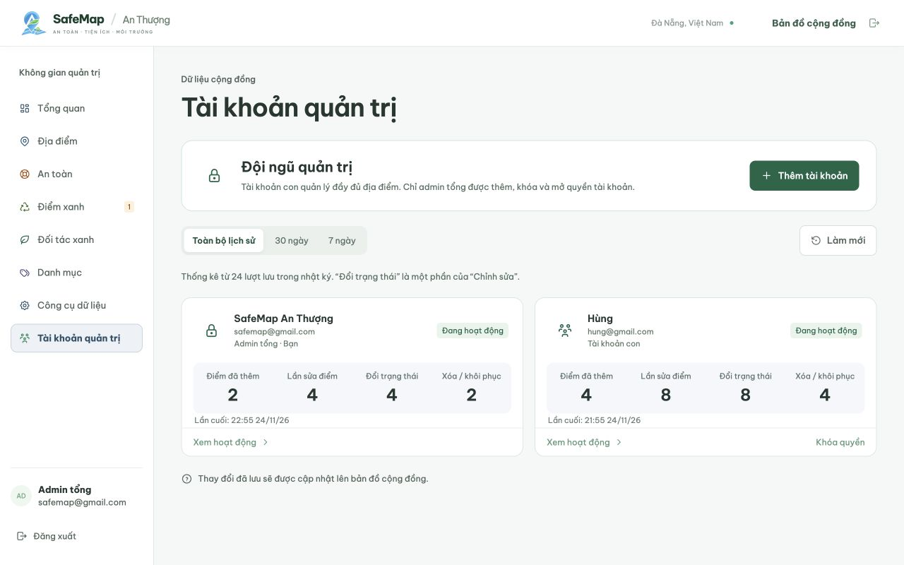
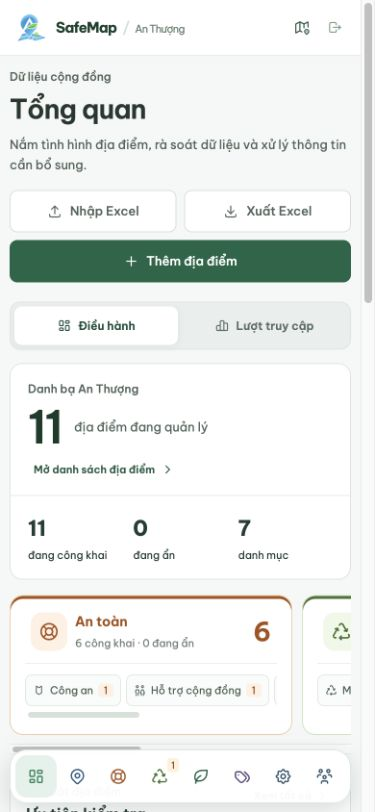

# SafeMap An Thượng — hướng dẫn bàn giao và vận hành

Ngày soạn: **24/11/2026**. Dự kiến bàn giao: **25/11/2026**; hai bên điền lại ngày thực tế trong biên bản.

Tài liệu dành cho người bàn giao, cán bộ tiếp nhận và kỹ thuật viên bảo trì. Không ghi mật khẩu, private key, mã khôi phục hoặc OTP vào tài liệu này.

## 1. Phương án đề xuất

**Giữ nguyên dự án Firebase hiện tại, chuyển quyền quản lý cho đơn vị tiếp nhận, bàn giao repository/source và Vercel, rồi gắn tên miền do đơn vị tiếp nhận đứng tên.** Cách này giữ nguyên dữ liệu, UID tài khoản và kết nối đang chạy; không cần chuyển cơ sở dữ liệu sang dự án mới chỉ để đổi người quản lý.

Thông tin đang dùng:

| Hạng mục | Thông tin |
| --- | --- |
| Website hiện tại | https://safe-murex-eta.vercel.app/ |
| Quản trị | https://safe-murex-eta.vercel.app/admin |
| Firebase / Google Cloud project | `safemap-82b28` |
| GA4 Property ID | `563291155` |
| Tên miền dự kiến | `safemap-anthuong.com` — chưa xác nhận còn trống hoặc đã mua |
| Nhà đăng ký dự kiến | P.A Việt Nam |
| Source | React + Vite; Node.js 22 trở lên; `npm ci`, `npm run build` |
| Dữ liệu chính | Firestore; ảnh hiện dùng URL, không upload vào Firebase Storage từ web |

**Bàn giao quyền sở hữu, không bàn giao mật khẩu Gmail cá nhân của người làm web.** Hướng dẫn dưới đây là các việc cần thực hiện; tài liệu không xác nhận các quyền cloud/tên miền đã được chuyển.

## 2. Phân biệt các loại tài khoản

| Lớp tài khoản | Chức năng | Cách bàn giao |
| --- | --- | --- |
| Admin tổng SafeMap | Quản lý điểm, cán bộ và hoạt động trong website | Firebase Authentication + document `editors/{UID}` có `active: true`, `role: superadmin` |
| Cán bộ SafeMap | Có các nghiệp vụ địa điểm; không quản lý tài khoản cán bộ | Admin tổng tạo từ mục **Tài khoản** |
| Tài khoản Google quản lý Firebase | Quản lý dự án cloud, Auth, Firestore, Rules, quyền truy cập | Mời tài khoản Google của đơn vị vào dự án với vai trò được thống nhất |
| Tài khoản Google quản lý GA4 | Xem báo cáo, quản lý tài sản và cấp quyền báo cáo | Cấp quyền trong GA4, độc lập với quyền Firebase |
| Tài khoản Vercel | Quản lý deploy, biến môi trường, tên miền | Chuyển project sang phạm vi/team của đơn vị tiếp nhận |
| Tài khoản GitHub/Git | Giữ source và quyền phát hành bản mới | Chuyển repository hoặc bàn giao repository riêng thuộc đơn vị |
| Tài khoản P.A / chủ thể tên miền | Quản lý đăng ký, DNS, liên hệ, gia hạn | Đơn vị tiếp nhận đứng tên và giữ quyền truy cập/khôi phục |

### Lưu ý về `safemap@gmail.com`

Email đăng nhập admin trong Firebase Authentication **không chứng minh người dùng sở hữu hộp thư Gmail cùng tên**. Trước khi dùng email đó để mua tên miền hoặc khôi phục tài khoản, phải xác nhận đăng nhập và nhận thư được ở Gmail thật.

Nếu không sở hữu hộp thư, dùng email thật của đơn vị cho các dịch vụ bên ngoài. Để đổi admin tổng sang email thật, kỹ thuật viên tạo người dùng Auth tương ứng và cấp vai trò trong Firestore bằng quyền Console; kiểm tra đăng nhập thành công trước khi thu hồi tài khoản tạm. Không sửa UID ngẫu nhiên hoặc cấp `superadmin` cho toàn bộ cán bộ.

## 3. Nên mua tên miền bằng email nào?

**Nên dùng email do phường/đơn vị tiếp nhận kiểm soát lâu dài.** Ưu tiên email công vụ hoặc tài khoản Google/Workspace được đơn vị quản lý. Nếu dùng Gmail riêng cho dự án, đơn vị phải thực sự sở hữu hộp thư, số điện thoại khôi phục, phương án xác thực hai bước và mã khôi phục.

Không đặt việc gia hạn/khôi phục phụ thuộc duy nhất vào Gmail cá nhân của người làm web. Một email kỹ thuật cá nhân có thể là đầu mối hỗ trợ theo thỏa thuận, còn quyền sở hữu và khôi phục thuộc bên nhận.

Trước khi mua tại P.A Việt Nam:

1. Chốt đúng tên miền, thời hạn đăng ký và bên chịu phí gia hạn; kiểm tra giá gia hạn ngoài giá mua năm đầu.
2. Chốt **chủ thể đăng ký** với đơn vị: tổ chức/cơ quan hoặc người đại diện được chấp thuận. Email đăng ký và tên chủ thể là hai trường khác nhau; mua bằng email của đơn vị chưa thay thế việc khai đúng chủ thể.
3. Dùng thông tin thật và làm xác thực/hồ sơ P.A yêu cầu cho đúng loại tên miền. Chưa có tên miền thì dùng hộp thư đang hoạt động; không điền địa chỉ thuộc tên miền mới nếu hộp thư đó chưa tồn tại.
4. Đơn vị giữ tài khoản P.A, mã khách hàng/PA-ID, email nhận thông báo, hóa đơn và ngày hết hạn. Lưu phương án khôi phục bằng kênh bảo mật riêng.
5. Chốt người nhận thông báo và lịch kiểm tra gia hạn. Bật tự gia hạn nếu dịch vụ/gói hỗ trợ và đơn vị đã thống nhất cách thanh toán.

P.A có hướng dẫn [kiểm tra/đăng ký tên miền](https://www.pavietnam.vn/vn/tin-tuc-huong-dan-cach-kiem-tra-ten-mien-va-dang-ky.html) và [gia hạn](https://www.pavietnam.vn/vn/quitrinh-giahan-tenmien.html). Xác nhận thủ tục chủ thể trực tiếp với P.A trước khi thanh toán nếu bên nhận là cơ quan/tổ chức.

## 4. Trình tự bàn giao nên thực hiện

| Bước | Việc làm | Điều kiện hoàn tất |
| --- | --- | --- |
| 1 | Chốt phạm vi, người nhận và email thật | Có danh sách người nhận quyền và người chịu trách nhiệm phí |
| 2 | Chốt bản source, deploy và ghi mã commit/deployment | Biết chính xác bản nào được nghiệm thu |
| 3 | Sao lưu dữ liệu và cấu hình | Có file/bucket backup, thời điểm và người giữ; biết giới hạn bản sao |
| 4 | Mời bên nhận vào Firebase và GA4 | Bên nhận tự đăng nhập xem đúng dự án/tài sản |
| 5 | Bàn giao Git và Vercel | Bên nhận lấy source, build và xem cấu hình deploy được |
| 6 | Đăng ký/gắn domain | DNS hợp lệ, HTTPS hoạt động, kiểm tra trên điện thoại |
| 7 | Đổi thông tin tạm, thay khóa và kiểm tra | Tài khoản của bên nhận dùng được, nguồn dữ liệu vẫn đúng |
| 8 | Nghiệm thu, ký xác nhận, chốt bảo trì | Ghi người giữ quyền, lịch gia hạn, backup và cách xử lý lỗi |
| 9 | Thu hồi quyền người bàn giao theo thỏa thuận | Bên nhận còn quyền quản lý độc lập; không bị khóa ngoài dự án |

Không thu hồi quyền người bàn giao trước khi bên nhận xác nhận tự thao tác được. Tên miền có thể mua trước; khi cấu hình production, nên gắn vào project Vercel mà bên nhận sẽ quản lý lâu dài.

## 5. Sao lưu Firebase trước bàn giao

### 5.1. Hiểu đúng từng loại bản sao

| Bản sao | Có gì | Không thay thế được gì |
| --- | --- | --- |
| **Xuất Excel trong admin SafeMap** | Thông tin địa điểm phục vụ đối chiếu/nhập dữ liệu | Không phải backup đầy đủ Firestore; không giữ toàn bộ lịch sử, thùng rác, xác minh, quyền Auth/IAM và cấu hình dịch vụ |
| **Export Firestore** | Document trong cơ sở dữ liệu được xuất | Không xuất Firebase Auth, Rules, IAM, biến Vercel hoặc file ảnh bên ngoài |
| **Export Firebase Auth** | Danh sách tài khoản Auth và dữ liệu xuất được theo quyền/thuật toán | Không tạo bản sao các document phân quyền `editors`, cấu hình provider hoặc toàn bộ dự án cloud |
| **Source + cấu hình triển khai** | Code, Rules trong repo, hướng dẫn build/deploy | Không tự chứa dữ liệu production hoặc các bí mật ngoài repo |
| **Bản sao ảnh/tài liệu gốc** | File ảnh và nguồn lưu trữ do đơn vị quản lý | URL ảnh trong Firestore không bảo đảm còn ảnh nếu chủ nguồn xóa hoặc đổi chia sẻ |

Workbook xuất hiện tại không giữ đầy đủ metadata của từng điểm và danh mục. Không gọi file Excel đó là bản sao có thể phục hồi toàn bộ hệ thống.

### 5.2. Các collection của dự án cần lưu

- `catalogs` — bản công khai, document chính `an-thuong`.
- `management` — bản quản trị, gồm thông tin không công khai/thùng rác, document chính `an-thuong`.
- `catalogHistory` — nhật ký và bản trước sửa.
- `placeReports` — phản ánh và kết quả xử lý.
- `editors` — vai trò và trạng thái cán bộ.

Lưu toàn bộ collection thay vì chỉ chép dữ liệu đang nhìn thấy trong bảng danh sách. Đối chiếu thực tế Console nếu sau này có thêm collection hoặc subcollection.

### 5.3. Export Firestore được quản lý bởi Google

Dịch vụ export/import được quản lý **cần bật billing/Blaze và có thể phát sinh phí đọc/ghi, lưu Cloud Storage**. Không tự bật thanh toán khi chưa thống nhất chi phí với bên nhận. [Hướng dẫn và chi phí chính thức](https://firebase.google.com/docs/firestore/manage-data/export-import).

Nếu đã dùng gói phù hợp:

1. Thống nhất khoảng tạm ngừng sửa dữ liệu để bản sao dễ đối chiếu. Export không bảo đảm là snapshot đúng một thời điểm bắt đầu nếu vẫn có ghi trong lúc chạy.
2. Google Cloud Console → đúng project `safemap-82b28` → **Firestore → Databases → (default) → Import/Export → Export**.
3. Chọn export toàn bộ database, chọn bucket Cloud Storage của bên nhận với cấu hình vị trí/quyền phù hợp theo hướng dẫn Google.
4. Đợi trạng thái hoàn tất. Ghi URI export, database, thời gian, số lượng document đối chiếu và tài khoản chịu trách nhiệm.
5. Kiểm tra quyền truy cập bucket của bên nhận; không bật public cho dữ liệu backup.
6. Lưu riêng Rules, cấu hình Auth, IAM, GA4 và biến triển khai theo các mục bên dưới.

Nếu chưa bật billing, giữ nguyên project khi chuyển quyền là phương án bàn giao đơn giản. Excel vẫn hữu ích để đối chiếu, nhưng nếu yêu cầu có backup đầy đủ thì cần thống nhất cách export. Một bản JSON logic do kỹ thuật viên đọc toàn bộ collection có thể là phương án khác; repo hiện **chưa cung cấp công cụ backup/restore JSON đầy đủ được kiểm chứng**, nên không coi đó là tính năng có sẵn.

### 5.4. Sao lưu Firebase Authentication

Kỹ thuật viên có quyền Google Cloud/Firebase phù hợp dùng Firebase CLI chính thức. Thực hiện trên máy của người giữ bản sao:

```bash
mkdir -p backup-private.local
firebase login
firebase auth:export backup-private.local/auth-users.json --format=json --project safemap-82b28
```

`firebase login` đăng nhập **tài khoản Google quản lý dự án**, không dùng mật khẩu admin SafeMap. Nếu chưa có CLI, cài Firebase CLI từ hướng dẫn chính thức của Firebase.

Kiểm tra file xuất có tài khoản cần giữ và UID. Để phục hồi mật khẩu sang dự án khác, kỹ thuật viên phải xử lý đúng thuật toán/tham số hash; lưu tham số hash bằng kênh bí mật riêng theo [hướng dẫn Auth export/import](https://firebase.google.com/docs/cli/auth). Không đưa file Auth, hash hoặc khóa vào Git, email công khai hoặc nhóm chat.

Thư mục `backup-private.local/` được mẫu `*.local` trong `.gitignore` bỏ qua, nhưng bên nhận vẫn phải lưu bản sao ở nơi bảo mật khác; Git ignore không mã hóa dữ liệu.

### 5.5. Thử khả năng khôi phục

Chọn dự án thử riêng nếu cần thử restore, không import đè production để kiểm tra. Kỹ thuật viên phục hồi document, tài khoản Auth/UID và các cấu hình liên quan; đối chiếu điểm công khai/ẩn/thùng rác, lịch sử, vai trò và đăng nhập. Ghi kết quả thử vào biên bản. Không đổi UID của tài khoản mà bỏ quên document `editors/{UID}`.

## 6. Chuyển quyền Firebase / Google Cloud

1. Chủ dự án hiện tại mở Firebase Console → **Project settings → Users and permissions**; hoặc Google Cloud → **IAM & Admin → IAM**.
2. Mời tài khoản Google thật của đơn vị tiếp nhận với vai trò sở hữu/quản lý đã thống nhất. Bên nhận phải xác nhận tự mở đúng project và xem Auth/Firestore được.
3. Ghi các dịch vụ đang bật: Firestore, Email/Password Auth; Anonymous Auth nếu dùng gửi phản ánh; API Analytics Data cho báo cáo.
4. Kiểm tra Rules đang xuất bản khớp `firestore.rules` của bản nghiệm thu. Bàn giao cả `firebase.json` và các thiết lập/index đang dùng trong Console.
5. Nếu có billing, chốt riêng tài khoản thanh toán, người quản lý phí và cảnh báo ngân sách; thêm Owner dự án không tự chuyển phương thức thanh toán.
6. Kiểm tra service account, khóa và quyền kỹ thuật đang dùng. Chỉ giữ các quyền cần thiết; thỏa thuận rõ bạn còn bảo trì hay sẽ rút quyền.
7. Sau nghiệm thu, điều chỉnh/thu hồi quyền người bàn giao theo biên bản. Không xóa tài khoản Google cá nhân để thay cho chuyển quyền dự án.

Vai trò admin trong SafeMap không cấp quyền vào Console. Tham chiếu [quản lý thành viên dự án Firebase](https://firebase.google.com/support/faq#permissions-iam).

## 7. Bàn giao source và Git

Bộ source tối thiểu:

- `src/`, `public/`, `api/`, `scripts/`, `docs/`.
- `package.json`, `package-lock.json`, `vite.config.js`, `index.html`.
- `vercel.json`, `firebase.json`, `firestore.rules`, `.env.example`, `.gitignore`, `README.md`.
- Mã commit/nhánh/tag nghiệm thu, đường dẫn repository, deployment production và danh sách thay đổi chưa deploy.

Ưu tiên repository thuộc GitHub organization/tài khoản của bên nhận; cấp quyền cho người bảo trì theo hợp đồng. Nếu dùng chức năng chuyển repository, kiểm tra lại Git integration của Vercel sau chuyển. Bản ZIP là bản bổ sung; giữ repository có lịch sử để người bảo trì truy vết và rollback được.

Bên nhận kiểm tra từ một thư mục/máy mới:

```bash
npm ci
npm test
npm run test:ui
npm run build
```

Chạy `npm run dev` sau khi đặt cấu hình cục bộ riêng nếu cần phát triển. Vite development không có API server Vercel; muốn thử `/api/traffic` cục bộ cần môi trường phù hợp như `vercel dev`.

Không đưa `node_modules`, bản build `dist`, `.env.local`, tệp service account, backup hay khóa vào repository/ZIP source công khai. Chuyển bí mật bằng kênh riêng có người nhận xác định. Không coi việc có thư mục `dist` là đã bàn giao đầy đủ source và cấu hình vận hành.

## 8. Bàn giao Vercel và cấu hình môi trường

### 8.1. Chuyển project

Bên nhận tạo tài khoản/phạm vi Vercel phù hợp với mục đích sử dụng và thống nhất gói/phí. Theo luồng hiện tại của Vercel: chủ phạm vi nguồn và thành viên phạm vi đích vào **Project → Settings → General → Transfer Project**, xem lại danh sách được chuyển trước khi xác nhận. Nếu không đủ điều kiện chuyển giữa các phạm vi/gói, kỹ thuật viên triển khai project mới từ repository của bên nhận và kiểm tra trước khi đổi DNS/domain.

Sau chuyển, kiểm tra Git integration, nhánh production, Node version, build command `npm run build`, output `dist`, Functions `/api/traffic`, domain và biến môi trường. Vercel chuyển nhiều thiết lập/biến project, nhưng một số integration cần cài lại; không mặc định mọi dịch vụ liên kết đều đã được chuyển. [Hướng dẫn transfer Vercel](https://vercel.com/docs/projects/transferring-projects).

Giữ project/đường dẫn đang chạy cho đến khi xác nhận bản đích hoạt động. Nếu tạo project mới, URL `.vercel.app` có thể thay đổi; ghi lại và kiểm tra QR/link đã phát hành.

### 8.2. Danh sách biến cần bàn giao

| Tên biến | Mục đích | Cách giữ |
| --- | --- | --- |
| `VITE_FIREBASE_API_KEY` | Firebase Web config | Cấu hình client; không nhầm với private key |
| `VITE_FIREBASE_AUTH_DOMAIN` | Auth domain của Firebase | Cấu hình client |
| `VITE_FIREBASE_PROJECT_ID` | `safemap-82b28` khi giữ project hiện tại | Cấu hình client/server |
| `VITE_FIREBASE_APP_ID` | Web App ID | Cấu hình client |
| `VITE_FIREBASE_MEASUREMENT_ID` | Mã đo GA4 dạng `G-...` | Cấu hình client |
| `GA4_PROPERTY_ID` | ID tài sản dạng số | Cấu hình server |
| `GA4_CLIENT_EMAIL` | Service account đọc GA4 | Cấu hình server |
| `GA4_PRIVATE_KEY` | Khóa ký xác thực tài khoản báo cáo | Bí mật server, không thêm tiền tố `VITE_` |

Ghi rõ môi trường **Production/Preview/Development**, nhưng không chép giá trị bí mật vào Markdown này. Biến `VITE_` được đưa vào JavaScript khi build nên thay biến phải build/deploy lại. Hạn chế dùng dữ liệu Firebase production cho nhánh thử có quyền ghi.

Các khóa riêng đã từng gửi qua chat cần được thay thế: bên nhận tạo/giữ khóa mới của service account báo cáo, cập nhật Vercel, deploy và kiểm tra, rồi thu hồi khóa cũ. Không gửi khóa mới qua chat. Mật khẩu tạm/mẫu của admin cũng cần đổi bằng quy trình do bên nhận thực hiện.

## 9. Gắn domain mua tại P.A vào Vercel

1. Mở project Vercel production do bên nhận quản lý → **Settings → Domains**. Thêm `safemap-anthuong.com` và `www.safemap-anthuong.com` nếu sử dụng cả hai.
2. Chọn một địa chỉ chính; cấu hình địa chỉ còn lại chuyển hướng về địa chỉ chính.
3. Trong P.A, mở quản lý DNS của tên miền. Nếu DNS hiện do nhà cung cấp khác quản lý, sửa ở nơi nameserver đang trỏ tới.
4. Chép **đúng bản ghi Vercel đang yêu cầu cho project đó**. Domain gốc thường dùng A, `www` thường dùng CNAME; thêm TXT xác minh nếu Vercel yêu cầu. Không chép IP/CNAME của một bài hướng dẫn cũ.
5. Không đổi nameserver nếu chỉ cần thêm bản ghi. Giữ các bản ghi email/MX/TXT đang phục vụ email của đơn vị.
6. Đợi Vercel báo cấu hình hợp lệ và HTTPS hoạt động. Kiểm tra cả Wi-Fi và mạng di động; thời gian DNS thay đổi phụ thuộc cache/TTL, không hứa chính xác vài phút.
7. Thêm tên miền mới vào Firebase Authentication → **Settings → Authorized domains** và kiểm tra đăng nhập admin/gửi phản ánh trên domain mới. Với đăng nhập Email/Password hiện tại, đây là bước rà cấu hình chuyển domain; không đổi `authDomain` sang domain mới một cách tùy tiện.
8. Trong GA4, tiếp tục dùng tài sản hiện tại để giữ lịch sử, cập nhật URL luồng Web và thử Realtime trên domain chính. Dashboard hiện cộng đường dẫn `/` theo thuộc tính, không tự tách mọi hostname.
9. Tạo lại QR chính thức bằng domain chính và kiểm tra QR đã in/link đã chia sẻ trước đó. Link ảnh ngoài domain cũng phải còn truy cập được.

Thêm custom domain không tự chuyển quyền Firebase hoặc GA4. Tham chiếu [thêm domain Vercel](https://vercel.com/docs/domains/working-with-domains/add-a-domain).

## 10. Bàn giao GA4 và cách đọc thống kê

1. Trong GA4 → **Quản trị → Quản lý quyền truy cập vào tài sản**, thêm tài khoản Google của bên nhận. Người quản lý lâu dài cần quyền phù hợp để tiếp tục quản lý người dùng; người chỉ xem báo cáo dùng quyền Người xem.
2. Xác nhận đúng tài sản `563291155`. Firebase project, mã đo `G-...` và ID tài sản là các thông tin khác nhau.
3. Kiểm tra service account báo cáo có quyền Người xem ở đúng tài sản và Google Analytics Data API đã bật.
4. Xác nhận phương diện **Mã địa điểm**, phạm vi **Sự kiện**, thông số **`place_id`** đã được tạo. Sự kiện chi tiết chỉ có từ bản tracking mới; không dựng lại lịch sử trước đó.
5. Mở website không đăng nhập, thử một điểm và đối chiếu Realtime. Trong admin, ô 30 phút và báo cáo ngày là hai kỳ khác nhau.
6. Báo cáo ngày có độ trễ; trạng thái “Chưa có dữ liệu ngày” không phải 0 khách thật. Truy vấn Realtime lỗi phải xem mã lỗi cụ thể; không giải thích mọi dấu “—” bằng việc đợi 24–48 giờ.

GA4 không đếm danh sách con người được xác minh; đổi thiết bị/trình duyệt có thể thay cách tính. Vị trí khu vực là ước tính GA4, không phải GPS chính xác. Các vòng tròn trên bản đồ mức độ quan tâm là vị trí địa điểm, không phải vị trí khách.

Hướng dẫn chi tiết: [Lượt truy cập](HUONG_DAN_LUOT_TRUY_CAP.md). Quyền GA4 được quản lý riêng theo [hướng dẫn Google](https://support.google.com/analytics/answer/9305788?hl=vi).

## 11. Danh sách kiểm tra trước ký nhận

### Người dùng công cộng

- [ ] Mở domain chính trên Android/iPhone và máy tính, không cần tài khoản.
- [ ] Lời chào, chuyển Việt/Anh, tìm không dấu, lọc nhóm/danh mục/mức hỗ trợ và xóa lọc hoạt động.
- [ ] Điểm An toàn màu cam; Điểm xanh xanh lá nhạt; Đối tác xanh xanh đậm. Mức hỗ trợ chỉ bổ sung cho Hỗ trợ cộng đồng.
- [ ] Mở chi tiết, thử ảnh có/không có URL, lịch mở cửa, số liên hệ và trạng thái.
- [ ] Thử GPS được cho phép và bị từ chối; chỉ đường có phương án chọn điểm xuất phát/thử lại.
- [ ] Thử lưu, chia sẻ/QR, liên kết mở thẳng điểm. Không gọi thử đầu số khẩn cấp để nghiệm thu.
- [ ] Gửi phản ánh có ghi rõ đây là thử nghiệm được thống nhất và kiểm tra cán bộ nhận được.

### Admin tổng và cán bộ

- [ ] Admin tổng thấy **Tài khoản trong sidebar/dock**; cán bộ không thấy và không truy cập được chức năng này.
- [ ] Dock mobile chỉ hiện icon, trạng thái đang chọn đúng, có tên hỗ trợ trình đọc màn hình.
- [ ] Thêm/sửa điểm thử có nhãn demo, vị trí bằng ghim/tọa độ/Plus Code, chọn đúng nhóm/danh mục/mức hỗ trợ.
- [ ] Xác nhận lưu xong; tải lại trang/mở máy thứ hai kiểm tra đồng bộ. Kiểm tra lịch sử ai đã thay đổi.
- [ ] Thử ẩn/công khai, chuyển thùng rác và khôi phục trên điểm thử; không dùng dữ liệu thật để thử xóa.
- [ ] Nhập Excel có xem trước, báo lỗi/trùng; xuất Excel đọc được.
- [ ] Tổng quan, công cụ dữ liệu, phản ánh và lịch sử đủ thông tin để xác định đúng điểm.
- [ ] Admin tổng thử tạo/khóa tài khoản cán bộ demo; tài khoản đó mất quyền nghiệp vụ sau khi khóa.
- [ ] Báo cáo Realtime truy cập được; ghi nhận riêng nếu báo cáo ngày/phương diện mới còn chờ GA4.

### Kỹ thuật và quyền sở hữu

- [ ] Source mới nhất đã được deploy; ghi mã commit và deployment URL trong biên bản.
- [ ] Bên nhận tự mở được Firebase, GA4, Git, Vercel và P.A bằng tài khoản của họ.
- [ ] Có bản sao phù hợp, biết ai giữ, thử đọc/khôi phục ở môi trường riêng nếu thuộc phạm vi nghiệm thu.
- [ ] Không có tệp khóa, mật khẩu, `.env.local` hoặc backup trong repository/ZIP source công khai.
- [ ] Khóa đã lộ được thay; mật khẩu tạm được đổi; phương án khôi phục và xác thực hai bước do bên nhận giữ.
- [ ] HTTPS, DNS, domain chính, link ảnh và QR đã kiểm tra; có người chịu trách nhiệm gia hạn.
- [ ] Bên nhận biết cách rollback và biết liên hệ ai khi xảy ra lỗi.

## 12. Vận hành sau bàn giao và giới hạn hiện tại

| Chu kỳ | Việc nên làm | Người phụ trách |
| --- | --- | --- |
| Trước/sau đợt nhập dữ liệu lớn | Xuất bản sao phù hợp, đối chiếu lỗi/trùng, ghi lần cập nhật | Cán bộ dữ liệu + kỹ thuật |
| Hằng tuần | Xem phản ánh, điểm chưa xác minh, số điện thoại/giờ mở cửa/URL ảnh | Cán bộ quản trị |
| Hằng tháng | Kiểm tra backup và thử đọc, quyền cán bộ, dung lượng/quota, bản deploy | Kỹ thuật/đầu mối đơn vị |
| Trước hạn domain 30–60 ngày | Kiểm tra email nhắc hạn, phương thức thanh toán và gia hạn | Người quản lý domain |
| Khi đổi nhân sự | Khóa quyền app/IAM/Git/Vercel phù hợp và cập nhật người chịu trách nhiệm | Đầu mối được ủy quyền |

Giới hạn source hiện tại: tối đa 200 điểm kể cả ẩn/thùng rác, 40 danh mục và khoảng 800 KB JSON danh bạ. Lịch sử lưu dữ liệu trước sửa nên cần theo dõi dung lượng khi dùng lâu dài. Nếu tăng quy mô vượt giới hạn, cần nâng cấu trúc dữ liệu; không tự xóa lịch sử để che cảnh báo.

GPS, bản đồ nền, tính tuyến, ảnh URL và GA4 phụ thuộc thiết bị/mạng/dịch vụ ngoài. Lưu địa điểm chỉ nằm trên trình duyệt hiện tại. Ảnh dùng URL công khai: giữ bản gốc thuộc đơn vị và kiểm tra URL trả trực tiếp nội dung ảnh; link trang xem Google Drive không tự động là URL ảnh.

Nếu có lỗi sau deploy, rollback về deployment đã xác nhận trên Vercel, kiểm tra lại người dùng/admin rồi ghi lỗi cho kỹ thuật. Rollback code không tự khôi phục dữ liệu Firestore; phục hồi dữ liệu là quy trình riêng từ bản sao.

## 13. Mẫu biên bản bàn giao ngắn

| Nội dung | Ghi nhận thực tế |
| --- | --- |
| Ngày giờ / bên giao / bên nhận | … |
| Đầu mối dữ liệu / kỹ thuật / domain | … |
| Domain chính và ngày hết hạn | … |
| Chủ thể tên miền / email nhận thông báo | … |
| Git repo / commit hoặc tag nghiệm thu | … |
| Vercel project/team / deployment production | … |
| Firebase project / người giữ quyền quản lý | … |
| GA4 Property / người quản lý | … |
| Admin tổng / cán bộ đã cấp | Chỉ ghi email/UID; mật khẩu chuyển riêng |
| Backup Firestore / Auth / source / ảnh | URI/vị trí riêng tư, ngày, người giữ, kết quả kiểm tra |
| Môi trường / billing / người chịu phí | … |
| Khóa và mật khẩu tạm đã thay | Người xác nhận, ngày; không ghi giá trị |
| Mục đã nghiệm thu | Tham chiếu danh sách kiểm tra ở mục 11 |
| Mục còn chờ và hạn xử lý | Ví dụ: data thật của phường, GA4 xử lý dữ liệu ngày, domain chờ DNS |
| Thời gian bảo hành / phạm vi bảo trì | … |
| Quyền của người bàn giao sau nghiệm thu | Giữ vai trò nào, đến ngày nào hoặc đã thu hồi |
| Xác nhận hai bên | … |

Tài liệu chức năng và thao tác: [Báo cáo chức năng](ban-giao/BAO-CAO-CHUC-NANG.md), [hướng dẫn sử dụng](ban-giao/HUONG-DAN-SU-DUNG.md), [ảnh giao diện](ban-giao/GIAO-DIEN.md). Các tài liệu theo ngày có thể phản ánh phiên bản cũ; đối chiếu source/deployment được ghi trong biên bản nghiệm thu.

## 14. Kiểm tra thay đổi điều hướng ngày 24/11/2026

- Mục **Tài khoản quản trị** nằm trong sidebar, chỉ hiện với admin tổng; đã bỏ nút trùng ở phần đầu trang.
- Dock mobile chỉ hiện icon, giữ tên truy cập cho trình đọc màn hình. Bố cục chia đều theo 7 mục của cán bộ hoặc 8 mục của admin tổng; đã kiểm tra màn hình rộng 320 px và 390 px.
- Đã chạy 74 kiểm tra đơn vị, 229 kiểm tra tích hợp React DOM và build production. Các kiểm tra tích hợp dùng dữ liệu thử, không ghi dữ liệu Firebase thật.
- Đã kiểm tra trực quan trên trình duyệt ở desktop và mobile. Ảnh dưới đây dùng dữ liệu mô phỏng cục bộ, không phải báo cáo hoạt động production.
- Các thay đổi trong mục này mới có ở source tại thời điểm soạn; cần commit/deploy bản mới và thử lại trên domain bàn giao. Chưa thực hiện chuyển quyền cloud, mua domain hoặc xuất bản sao dữ liệu bằng các bước kiểm tra giao diện này.

### Sidebar desktop



### Dock mobile



[Ảnh kiểm tra màn hình 320 px](ban-giao/dieu-huong-2026-11-24/dock-mobile-320.jpg).
