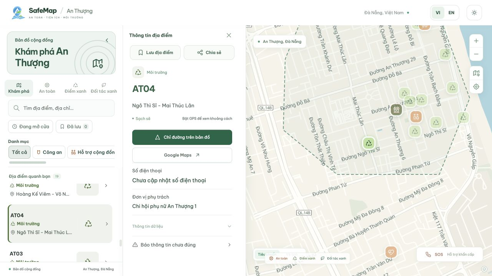

# Kiểm tra Realtime và 15 lượt truy cập thực tế

Ngày: 24/11/2026. Website: https://safe-murex-eta.vercel.app/.

## Triệu chứng xác nhận trên bản đang deploy

GA4 Realtime đã nhận `page_view`, `place_open`, `route_request`, `place_save`. Trong admin SafeMap, báo cáo ngày trả số 0 và ô 30 phút hiện dấu “—”, chưa tải được dữ liệu thời gian thực.

Đây là hai trạng thái khác nhau: báo cáo ngày có thể chưa được xử lý, còn ô Realtime đang không đọc được API. Không nên giải thích dấu “—” chỉ bằng thời gian chờ xử lý dữ liệu ngày.

## 15 lượt thử đã thực hiện

Dùng trình duyệt thật, không đăng nhập tài khoản người dùng, tải trang và mở chi tiết địa điểm sau mỗi lần tải. Đã hoàn tất 15 lượt:

1. Đinh Công Chức
2. Ut Phi Brunch n’ Coffee — Dịch vụ
3. Chung cư Mường Thanh
4. Bệnh viện 199 - Bộ Công an
5. Công an phường Ngũ Hành Sơn
6. Điểm trạm y tế Ngũ Hành Sơn 1
7. HKD JC GLOBAL
8. Ut Phi Brunch n’ Coffee — Hỗ trợ cộng đồng
9. AT10
10. AT09
11. AT08
12. AT06
13. AT07
14. AT05
15. AT04

Có một lượt phải đợi thêm dữ liệu danh bạ trước khi mở chi tiết; không tính lượt đó hoàn tất cho đến khi thấy đúng thông tin điểm. Trình duyệt có tải script `googletagmanager.com/gtag/js`, không thấy lỗi/warning trong log kiểm tra.

Đây là 15 lần mở website và chi tiết, **không phải 15 người dùng độc lập hoặc 15 thiết bị**. Không giả vị trí IP/GPS quanh An Thượng. Vị trí địa điểm được mở không phải vị trí người truy cập.

Lần đối chiếu GA4 sau thử hiển thị 3 người dùng hoạt động và 9 lượt xem trong 30 phút. Chưa xác nhận đủ 15 sự kiện thử đã vào GA4; cửa sổ 30 phút trượt và hoạt động của các thiết bị khác cũng ảnh hưởng số đang hiển thị. Không tự điền thêm lượt xem/người dùng hoặc số liệu giả vào báo cáo production.

## Bản sửa source

- Realtime dùng truy vấn tối giản `activeUsers` cho tổng người dùng và `minutesAgo` + `screenPageViews` cho biểu đồ phút. Dùng cửa sổ 30 phút mặc định của Google; bỏ bộ lọc tên sự kiện và khoảng phút tường minh khỏi các truy vấn này.
- Giữ mã lỗi an toàn của Google và HTTP status để phân biệt yêu cầu không hợp lệ, thiếu quyền, hết hạn mức, phản hồi chậm hoặc dịch vụ không khả dụng. Không trả token, private key hay thông điệp lỗi thô từ nhà cung cấp ra giao diện.
- Hiển thị nguyên nhân Realtime và ID tài sản ngay trong admin khi bị lỗi, thay vì chỉ có dấu “—”.
- Phản hồi phút bị sai định dạng không làm mất toàn bộ báo cáo chính.
- Bổ sung kiểm tra cấu trúc phản hồi, phân loại lỗi và trạng thái quyền Realtime trong UI.

Tham chiếu: [API Realtime](https://developers.google.com/analytics/devguides/reporting/data/v1/rest/v1beta/properties/runRealtimeReport), [chỉ số Realtime](https://developers.google.com/analytics/devguides/reporting/data/v1/realtime-api-schema).

## Kiểm chứng và giới hạn

- 73 test nghiệp vụ/API đạt.
- 223 kiểm tra tích hợp React DOM đạt.
- Build production đạt; cảnh báo chunk Firebase/MapLibre vẫn như trước.
- Chưa deploy bản sửa này. Đã kiểm chứng hai truy vấn mới với API GA4 thật, cả hai trả HTTP 200; xem kết quả bên dưới.
- Ban đầu macOS từ chối đọc Downloads. Sau đó người dùng chủ động cung cấp khóa để kiểm tra; khóa và access token chỉ được giữ trong bộ nhớ của tiến trình thử, không lưu vào source hay tệp cấu hình.

Khóa đã gửi qua chat cần được thu hồi và thay mới sau kiểm tra. Chỉ đặt khóa thay thế trong biến server `GA4_PRIVATE_KEY` trên Vercel, không gửi lại qua chat hoặc commit vào Git. Không thay quyền hay ghi dữ liệu Firebase trong lượt thử này.

Sau deploy, kiểm tra ô 30 phút. Nếu còn lỗi, đọc mã lỗi mới và ID tài sản trước khi thay cấu hình hoặc kết luận cần chờ thêm dữ liệu.

## Kết quả API GA4 thật sau khi được cấp khóa kiểm tra

Đã ký OAuth với phạm vi `analytics.readonly` và thử trên cùng tài sản đang dùng. Không tạo sự kiện hoặc thay số đếm bằng API.

| Truy vấn | HTTP | Kết quả tại thời điểm thử |
| --- | --- | --- |
| Người dùng Realtime cũ, có lọc `eventName` | 400 | `INVALID_ARGUMENT`: Selected dimensions and metrics cannot be queried together. |
| Người dùng Realtime mới, chỉ `activeUsers` | 200 | 3 người dùng |
| Biểu đồ phút cũ, `eventCount` lọc `page_view` | 200 | Tổng 30 lượt xem trên các hàng phút |
| Biểu đồ phút mới, `screenPageViews` theo `minutesAgo` | 200 | Cùng tổng 30 lượt xem |
| Báo cáo ngày hôm nay, lọc bản đồ `/` | 200 | Chưa có hàng dữ liệu |
| Báo cáo ngày hôm nay, bỏ bộ lọc đường dẫn | 200 | Cũng chưa có hàng dữ liệu |

**Nguyên nhân đã xác nhận:** yêu cầu tổng người dùng Realtime cũ kết hợp chỉ số và bộ lọc sự kiện không tương thích. Google trả 400; code cũ gộp số người và biểu đồ phút trong một trạng thái nên ô Realtime bị trống dù truy vấn biểu đồ phút đã thành công.

Bản sửa bỏ bộ lọc này và dùng `screenPageViews` cho biểu đồ phút. Đồng thời giữ biểu đồ phút hiển thị nếu chỉ riêng truy vấn người dùng bị lỗi; số người chưa tải được vẫn là dấu “—”, không thay bằng 0.

Số 0 ở báo cáo ngày không phải do bộ lọc `/` trong lần thử này: Google cũng chưa trả hàng dữ liệu khi bỏ lọc. Không dùng số Realtime để điền giả vào tổng theo ngày. 30 lượt xem là số liệu tổng trong cửa sổ thử, không khẳng định tất cả do 15 lượt kiểm thử tạo ra.

Sau khi deploy bản vá, kiểm tra ô Realtime và mã tài sản. Kiểm tra mã lỗi cụ thể nếu truy vấn tiếp tục thất bại vì quyền, hạn mức hoặc mạng.

## Bổ sung sau khi Realtime đã hoạt động

Ảnh người dùng gửi lúc 22:34 cho thấy biểu đồ 30 phút đã có lượt, còn báo cáo ngày vẫn rỗng. Đã chỉnh UI phân biệt trạng thái báo cáo ngày chưa có dữ liệu với một báo cáo có số 0 thật; không thay thế số liệu theo ngày bằng Realtime.

Bổ sung cờ `dailyDataAvailable`, thông báo chờ báo cáo ngày, ký hiệu “—” cho chỉ số chưa có dữ liệu và trạng thái biểu đồ rỗng. Giữ nguyên số 0 khi báo cáo đã có hàng dữ liệu. Thời điểm truy vấn được ghi là “Kiểm tra lúc” để không tạo cảm giác dữ liệu GA4 đã được tổng hợp đến phút đó.

Kiểm tra sau thay đổi: 74 test nghiệp vụ/API, 226 kiểm tra React DOM và build production đạt. Bổ sung này chưa được deploy trong lượt làm việc.
