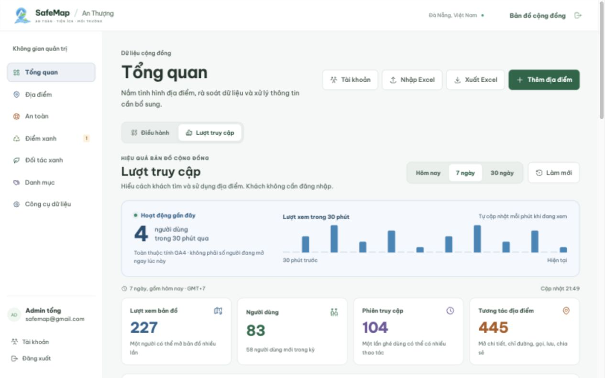
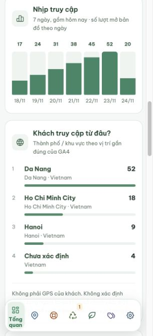
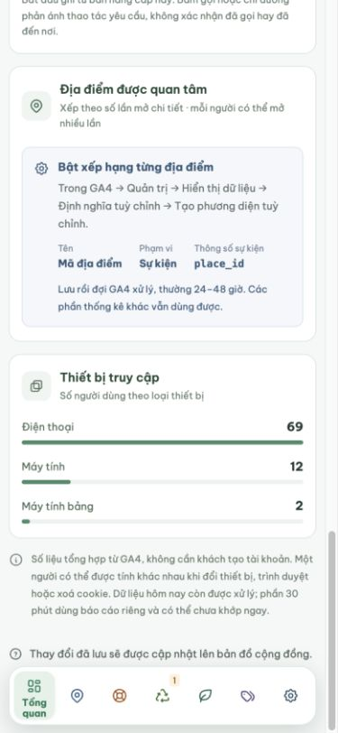

# Nâng cấp thống kê sử dụng SafeMap

Ngày: 24/11/2026. Source đã cập nhật; chưa deploy lên Vercel trong lượt làm việc này.

## Thay đổi cho quản trị

- Kỳ báo cáo Hôm nay / 7 ngày / 30 ngày, gồm ngày hiện tại theo múi giờ thuộc tính GA4.
- Người dùng hoạt động và lượt xem theo phút trong 30 phút gần nhất. Không gắn nhãn đây là số người đang kết nối ngay lúc này.
- Tổng lượt mở bản đồ, người dùng, phiên truy cập và tổng tương tác địa điểm; số người dùng mới được hiển thị bên dưới tổng người dùng.
- Biểu đồ theo ngày, tự điền ngày không có số liệu và dùng ngày theo múi giờ báo cáo.
- Tối đa 10 thành phố/khu vực truy cập theo ước tính địa lý GA4; có giải thích cho dữ liệu chưa xác định.
- Tổng thao tác mở chi tiết, yêu cầu chỉ đường trong web, mở Google Maps, bấm gọi, lưu điểm và mở chia sẻ/QR.
- Xếp hạng tối đa 20 địa điểm theo lượt mở, kèm số yêu cầu chỉ đường, bấm gọi và lưu. Tên/địa chỉ lấy từ danh bạ hiện tại; bấm một hàng mở đúng điểm trong admin. Điểm đã xóa không có nút mở.
- Bản đồ vòng tròn của các điểm trong bảng; không vẽ vị trí khách. Tải bản đồ khi admin yêu cầu và giữ nền bản đồ khi báo cáo được làm mới.
- Thống kê thiết bị, thông báo số liệu mới đang xử lý và tình huống GA4 áp dụng ngưỡng/gộp dữ liệu.
- Mobile dùng thẻ địa điểm có tên, địa chỉ và các chỉ số ngay dưới, không phải kéo ngang bảng.

## Thu thập từ bản đồ công cộng

Khách vẫn dùng bản đồ không cần tạo hoặc đăng nhập tài khoản. Các sự kiện mới chỉ gửi mã địa điểm công khai (`place_id`); không gửi GPS khách, nội dung tìm kiếm, email hay số điện thoại khách qua các sự kiện này.

Mở một điểm khác hoặc đóng rồi mở lại được tính là một lần mở chi tiết. Rerender, thay đổi ngôn ngữ hoặc lưu điểm khi chi tiết đang mở không tự cộng thêm lượt mở. Hover vào điểm không được tính như mở chi tiết. Thao tác chỉ đường/gọi/chia sẻ là yêu cầu của khách, không phải xác nhận chuyến đi, cuộc gọi hoặc lượt chia sẻ hoàn tất.

SDK được tải bất đồng bộ, giữ tối đa 20 thao tác trong lúc khởi tạo. Tắt trong bản Vite phát triển và khi ở đường dẫn admin; lỗi đo lường không được ngắt bản đồ. Không sử dụng dữ liệu hoặc khóa riêng đã dán trong chat để thử API.

## API và độ tin cậy

`/api/traffic?range=today|7d|30d` chỉ cho phép GET có token Firebase của quản trị đang hoạt động. Kiểm tra quyền qua Firestore trước mỗi lần đọc, kể cả khi dùng kết quả cache. Cache tách theo dự án, thuộc tính, service account và kỳ; tối đa 60 giây.

Báo cáo chính lọc đường dẫn bản đồ `/`. Realtime là báo cáo theo toàn thuộc tính với các sự kiện trang/tương tác; nên dùng thuộc tính GA4 dành riêng SafeMap. Trang tự cập nhật mỗi phút khi đang hiển thị; không chạy bộ đếm trong Firestore và không thay đổi Firebase Rules.

Realtime và bảng xếp hạng là các phần tùy chọn: lỗi API hoặc chưa khai báo phương diện không làm mất báo cáo chính. Nếu làm mới thất bại, giao diện giữ báo cáo xác nhận gần nhất và hiện thông báo chưa làm mới được. Đổi kỳ báo cáo không trộn kết quả của kỳ trước; yêu cầu cũ được hủy khi chuyển kỳ hoặc rời trang.

## Cần làm sau khi deploy

Giữ cấu hình GA4 đang dùng. Trong GA4 tiếng Việt → **Quản trị → Hiển thị dữ liệu → Định nghĩa tuỳ chỉnh → Tạo phương diện tuỳ chỉnh**:

| Trường | Giá trị |
| --- | --- |
| Tên phương diện | Mã địa điểm |
| Phạm vi | Sự kiện |
| Thông số sự kiện | `place_id` |

Sau deploy, mở bản đồ công khai trên điện thoại và mở vài địa điểm. Sự kiện được ghi từ bản mới; không dựng lại thao tác trước khi có tracking. Phương diện mới thường cần 24–48 giờ để báo cáo. Các báo cáo truy cập/khu vực/thiết bị vẫn hoạt động khi chưa khai báo phương diện.

Xem [hướng dẫn cấu hình và cách đọc số liệu](HUONG_DAN_LUOT_TRUY_CAP.md).

## Kiểm tra

- Unit/API: 72 test đạt. Có kiểm tra quyền bị từ chối, thiếu cấu hình, kỳ không hợp lệ, cache vẫn xác thực người đọc, lỗi Realtime, thiếu phương diện, xếp hạng có dữ liệu và lỗi báo cáo chính.
- 221 kiểm tra React DOM đạt, gồm luồng khách không đăng nhập, không đếm lại khi rerender, đổi kỳ, xếp hạng, mở đúng bản ghi, giữ nền bản đồ khi làm mới và giữ báo cáo cũ khi lỗi.
- Kiểm tra trình duyệt ở 1280×800, 390×844 và 320×700. Không thấy tràn ngang toàn trang; bảng xếp hạng chuyển thành thẻ trên mobile. Đã mở bản đồ vòng tròn và kiểm tra trạng thái chưa cấu hình phương diện.
- Build production và kiểm tra đồng bộ khi lưu đạt. Cảnh báo kích thước chunk Firebase/MapLibre vẫn còn như trước.
- Dùng dữ liệu/SDK giả lập để test và xem UI, không ghi lên dữ liệu Firebase thật. Chưa kiểm chứng các truy vấn báo cáo mới đầu cuối trên GA4 thật hoặc deploy chúng trong lượt này.

## Ảnh giao diện kiểm tra

**Các số trong ảnh là dữ liệu giả lập để kiểm tra bố cục, không phải số truy cập thực tế của SafeMap.** Các fixture chỉ nằm trong script kiểm tra cục bộ, không được đưa vào ứng dụng production.

### Tổng quan desktop

### Xếp hạng trên màn 320px

### Hướng dẫn khi chưa khai báo place_id

[Ảnh toàn bộ dashboard desktop, số liệu giả lập](ban-giao/traffic-2026-11-24/00-toan-trang-desktop.jpg).
