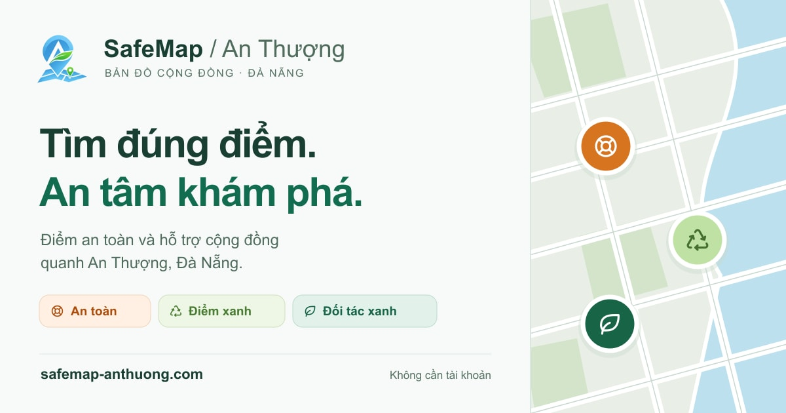

# SEO và ảnh chia sẻ SafeMap An Thượng

Ngày cập nhật: 25/11/2026. Domain chính: https://www.safemap-anthuong.com/.

## 1. Nội dung đã chuẩn bị trong source

- Tiêu đề, mô tả tiếng Việt, canonical về domain chính.
- Open Graph và Twitter Card trong HTML gốc, không phụ thuộc JavaScript. Ảnh JPEG 1200 × 630, khoảng 72 KB, dùng logo đã chốt và màu nhóm: An toàn cam, Điểm xanh xanh lá nhạt, Đối tác xanh xanh lá đậm.
- Dữ liệu có cấu trúc WebSite và WebPage cho trang chủ; AboutPage cho trang giới thiệu. Không khai báo đánh giá, chứng nhận, địa chỉ doanh nghiệp hoặc danh sách địa điểm không được xác minh.
- `robots.txt` cho phép thu thập nội dung và dẫn tới sitemap. Sitemap chỉ có trang chủ và trang giới thiệu; không chứa admin, API, dữ liệu quản trị hoặc game đã bỏ.
- Trang chủ có nội dung HTML dự phòng trước khi ứng dụng mở. Trang `/gioi-thieu/` có nội dung giới thiệu, nhóm điểm, ba mức hỗ trợ, hướng dẫn và câu hỏi thường gặp; đọc được khi tắt JavaScript. Liên kết “Về SafeMap” nằm trong hàng phân trang của màn hình chào.
- Trang quản trị dùng HTML riêng với `noindex, nofollow`, bỏ metadata chia sẻ công khai, đồng thời có header `X-Robots-Tag` trên Vercel. Không chặn `/admin` trong robots.txt để crawler đọc được lệnh noindex. Đây là cấu hình tìm kiếm; phân quyền Firebase hiện có vẫn là cơ chế bảo vệ dữ liệu.
- `npm run build` tự tạo trang giới thiệu, HTML quản trị và kiểm tra các file SEO. Cần deploy bằng lệnh này, không chạy riêng `vite build`.

## 2. Deploy bản cập nhật

1. Đưa toàn bộ thay đổi source lên repository đang nối với Vercel. Bao gồm thư mục `seo/`, `public/social/`, `public/site-info.css`, robots, sitemap và các script build/check SEO.
2. Giữ Build Command là `npm run build`, Output Directory là `dist`. Không cần thêm dịch vụ SEO trả phí hoặc thay Firebase Rules.
3. Sau khi Production deployment hoàn tất, mở trực tiếp các URL:
   - https://www.safemap-anthuong.com/
   - https://www.safemap-anthuong.com/gioi-thieu/
   - https://www.safemap-anthuong.com/robots.txt
   - https://www.safemap-anthuong.com/sitemap.xml
   - https://www.safemap-anthuong.com/social/safemap-an-thuong-v1.jpg
4. Thử đăng nhập tại `/admin` và `/admin/`. Kiểm tra ảnh chia sẻ bằng một tin nhắn mới sau deploy, không dùng tin nhắn đã gửi làm bằng chứng metadata mới.
5. Trong “Xem nguồn trang”, trang chủ cần có `og:image` và canonical; trang admin cần có `noindex`. Các header cấu hình trong `vercel.json` chỉ được xác nhận trên deployment thật; Vite dev server không tự áp dụng chúng.

## 3. Kết nối Google Search Console — thao tác bên tài khoản

GA4 đo truy cập; Search Console theo dõi việc thu thập và kết quả tìm kiếm. Không cần tạo thuộc tính GA4 mới để làm SEO.

1. Mở https://search.google.com/search-console/ bằng tài khoản Google bên nhận bàn giao quản lý. Nếu bạn xác minh trước, sau đó phải bàn giao quyền sở hữu Search Console.
2. Chọn **Thêm tài sản → Miền**, nhập `safemap-anthuong.com` (không có `https://`, `www` hay dấu `/`).
3. Google cấp một giá trị TXT dạng `google-site-verification=...`. Sao chép đúng giá trị mới được cấp; source không chứa token xác minh dùng chung.
4. Vào P.A Việt Nam → DNS → Cấu hình bản ghi tên miền → Thêm bản ghi:

   | Ô | Nội dung |
   |---|---|
   | Host | `@` |
   | Loại | `TXT` |
   | Giá trị | Toàn bộ chuỗi Google vừa cấp |
   | TTL | `3600` hoặc mặc định |

5. Lưu bản ghi TXT mới. Giữ nguyên bản ghi A và CNAME đang trỏ Vercel, cùng mọi TXT/MX khác đang sử dụng. Không thay Name Server.
6. Quay lại Search Console bấm **Xác minh**. Nếu chưa thấy TXT, chờ DNS cập nhật rồi thử lại. Giữ bản ghi xác minh sau khi thành công.
7. Mở **Sơ đồ trang web**, gửi `https://www.safemap-anthuong.com/sitemap.xml`.
8. Dùng **Kiểm tra URL** cho `https://www.safemap-anthuong.com/`, chọn kiểm tra URL đang hoạt động, kiểm tra nội dung Google đọc được rồi **Yêu cầu lập chỉ mục**. Làm tương tự với `/gioi-thieu/`.
9. Theo dõi mục lập chỉ mục trang và báo cáo hiệu suất. Các truy vấn ưu tiên là “SafeMap An Thượng”, “bản đồ An Thượng”, “điểm an toàn An Thượng”, “hỗ trợ cộng đồng An Thượng Đà Nẵng”. Không cần gửi yêu cầu liên tục mỗi ngày.

## 4. Ảnh xem trước Zalo, Facebook và các ứng dụng nhắn tin

- Ảnh mới chỉ có trên domain thật sau khi deploy. Đường dẫn ảnh phải trả về ảnh JPEG công khai, không phải trang đăng nhập hoặc HTML.
- Metadata có thể được lưu đệm theo URL. Tin nhắn cũ có thể giữ bản xem trước cũ; không thể bảo đảm mọi ứng dụng tự làm mới ngay.
- Với Facebook, có thể dùng https://developers.facebook.com/tools/debug/ để kiểm tra URL và yêu cầu lấy lại dữ liệu. Công cụ này không xóa cache của Zalo.
- Nếu Zalo chưa hiện ảnh, kiểm tra URL ảnh trước, thử gửi lại liên kết trong tin nhắn mới và chờ hệ thống lấy lại metadata. Không có thao tác trong source có thể ép mọi ứng dụng xóa cache.
- Bản xem trước liên kết địa điểm `?place=...` hiện dùng nhận diện chung của SafeMap. Bản này chưa tạo ảnh/tiêu đề riêng cho từng địa điểm. Mỗi điểm chưa có URL nội dung độc lập để lập chỉ mục riêng.
- Khi đổi thiết kế ảnh, xuất file tên phiên bản mới và sửa URL ở `index.html`. Build sẽ dùng cùng ảnh cho trang giới thiệu. File thiết kế nguồn là `seo/share-card.svg`, đã nhúng biểu tượng hiện hành. Ảnh chỉ là hình minh họa nhận diện, không mô tả phân bố địa điểm thực tế.

## 5. Nội dung và vận hành sau bàn giao

- Nhờ trang thông tin của phường và các cơ sở tham gia đặt liên kết tới domain chính trong bài giới thiệu SafeMap có ngữ cảnh phù hợp.
- Bổ sung dữ liệu thật, thông tin hỗ trợ, số liên hệ, ảnh và giờ hoạt động chính xác. Rà soát trang giới thiệu khi đổi chức năng, nhóm hoặc mức hỗ trợ.
- Không hứa vị trí đầu Google với các từ khóa rộng như “SafeMap” hoặc “điểm an toàn Đà Nẵng”. Ghi nhận trên Google không có thời hạn chắc chắn; thứ hạng còn phụ thuộc nội dung, cạnh tranh và các tín hiệu ngoài website.
- Ảnh Open Graph dành cho liên kết chia sẻ; ảnh lớn trong kết quả Google vẫn do Google lựa chọn. Metadata và sitemap không bảo đảm Google sẽ lập chỉ mục hay chọn đúng tiêu đề/ảnh theo yêu cầu.
- Nếu sau này có trang riêng cho từng địa điểm, cần tạo HTML công khai và metadata riêng, cập nhật canonical/sitemap, đồng thời xử lý điểm bị ẩn/xóa. Không lấy dữ liệu quản trị hoặc lịch sử làm nội dung SEO.
- Domain không `www` hiện chuyển 308 sang `www`; canonical, sitemap và ảnh dùng thống nhất `www`. Chưa thay cấu hình redirect của domain Vercel cũ trong tài khoản Vercel.

## 6. Kiểm tra trước bàn giao

- Chạy `npm run build`: tạo đủ file và chạy kiểm tra SEO tự động.
- `npm run test:ui`: kiểm tra chức năng React bằng DOM giả lập, không thay thế kiểm tra giao diện thật.
- Kiểm tra trang giới thiệu ở 320px, 390px và desktop, liên kết từ lời chào, đăng nhập quản trị và khả năng đọc HTML khi tắt JavaScript.
- Những kiểm tra cục bộ không thay thế việc kiểm tra HTTP, header Vercel và Search Console sau deploy. Chưa có thao tác xác minh Search Console hoặc yêu cầu lập chỉ mục được thực hiện thay chủ tài khoản.

## Nguồn tham khảo

- [Google: SEO cho JavaScript](https://developers.google.com/search/docs/crawling-indexing/javascript/javascript-seo-basics)
- [Google: Tên website và WebSite structured data](https://developers.google.com/search/docs/appearance/site-names)
- [Google: Chặn lập chỉ mục bằng noindex](https://developers.google.com/search/docs/crawling-indexing/block-indexing)
- [Google: Yêu cầu thu thập lại URL](https://developers.google.com/search/docs/crawling-indexing/ask-google-to-recrawl)
- [Giao thức Open Graph](https://ogp.me/)
