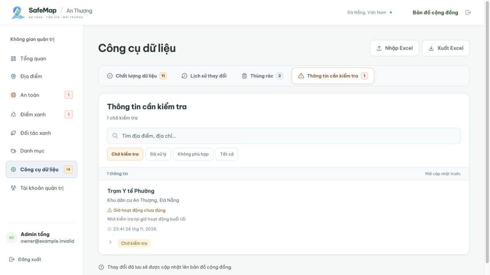
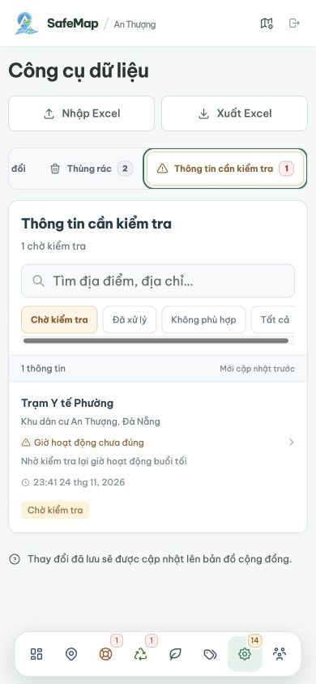
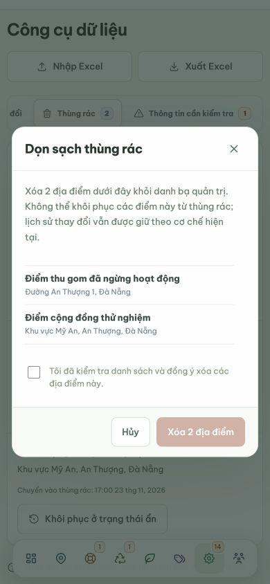
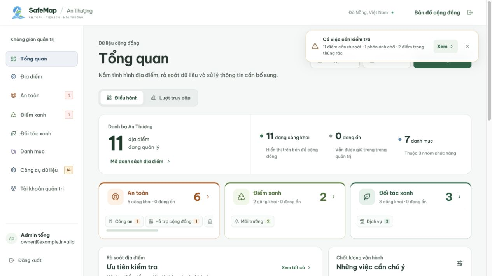

# Thông báo quản trị và dọn thùng rác

Thay đổi trong source ngày 24/11/2026. Chưa deploy, không xóa dữ liệu Firebase thật.

## Cách đếm thông báo

- Chất lượng dữ liệu: số địa điểm chưa xóa có ít nhất một vấn đề cần rà soát. Không cộng dồn từng trường thiếu trên cùng một điểm.
- Thông tin cần kiểm tra: tất cả phản ánh `status: new`, được nghe trực tiếp trong suốt phiên admin, kể cả khi đang mở trang khác. Truy vấn riêng không giới hạn vào 100 phản ánh gần nhất.
- Thùng rác: số điểm đã xóa mềm, có thể khôi phục hoặc dọn sau xác nhận.
- Công cụ dữ liệu trên sidebar/dock: tổng ba số trên. Đây là tổng việc, không phải số địa điểm duy nhất hoặc số chưa đọc.
- An toàn, Điểm xanh, Đối tác: số phản ánh chờ theo nhóm; Điểm xanh cộng thêm điểm có trạng thái cảnh báo/quá tải, không tính điểm trong thùng rác vào cảnh báo trạng thái.
- Lịch sử, Danh mục và Tài khoản không có badge tự tăng chỉ vì có dữ liệu. Lịch sử là nhật ký, không phải hàng đợi cần xử lý.

Badge tự cập nhật theo dữ liệu, số lớn rút gọn `99+`. Mở tab không đánh dấu công việc là đã hoàn tất. Lỗi nghe phản ánh hiển thị cảnh báo và nút thử lại; tổng chưa đầy đủ có dấu `+` hoặc `!`, không giả định phản ánh bằng 0.

## Popup nhỏ

Khi vào admin có việc hoặc có phản ánh mới, popup gọn có nút Xem và Đóng, tự ẩn sau 7 giây. Không lấy focus. Tạm ẩn khi đang chỉnh sửa địa điểm/danh mục hoặc mở thao tác nhập/xóa của trang quản trị. Không phát âm thanh, không gửi thông báo ngoài phiên web. Tôn trọng cài đặt giảm chuyển động.

## Dọn thùng rác

1. Mở Thùng rác và chọn Dọn sạch thùng rác.
2. Kiểm tra tên, địa chỉ và số lượng trong hộp xác nhận.
3. Tích đồng ý rồi chọn Xóa N địa điểm. Có thể hủy mà không thay đổi dữ liệu.
4. Chỉ các bản ghi đã xác nhận được loại khỏi danh bạ. Điểm còn hoạt động, đang ẩn và điểm mới chuyển vào thùng rác sau khi mở xác nhận được giữ lại.
5. Nếu bản ghi đã thay đổi/khôi phục ở phiên khác hoặc commit thất bại, hộp xác nhận giữ nguyên và hiển thị lỗi. Dùng cơ chế kiểm soát revision hiện tại khi lưu.
6. Lịch sử ghi nhận lần dọn, giữ snapshot theo cơ chế sẵn có. Không xóa lịch sử, tài khoản hoặc phản ánh. Vì vậy dọn thùng rác không phải chức năng xóa toàn bộ dữ liệu liên quan.

## Kiểm tra

- 79 kiểm tra đơn vị đạt, gồm kiểm tra cách đếm và bảo vệ dọn rác trước thay đổi đồng thời.
- 244 kiểm tra tích hợp React DOM đạt, gồm thông báo mới ở ngoài trang Công cụ, điều hướng từ popup, lỗi/thử lại subscription, phản ánh cũ đang chờ, giải quyết phản ánh, hủy/xóa/lưu lỗi của dọn rác.
- Build production thành công; cảnh báo bundle lớn Firebase/MapLibre đã có từ trước.
- Kiểm tra trực quan desktop và mobile 390 px/320 px bằng dữ liệu mô phỏng cục bộ. Các tab công cụ tự cuộn ngang để mục đang chọn nằm trong vùng nhìn thấy.
- Rules không thay đổi; truy vấn phản ánh dùng quyền đọc của cán bộ hiện có, dọn rác dùng giao dịch danh bạ và lịch sử hiện có.

## Ảnh minh họa bằng dữ liệu thử

