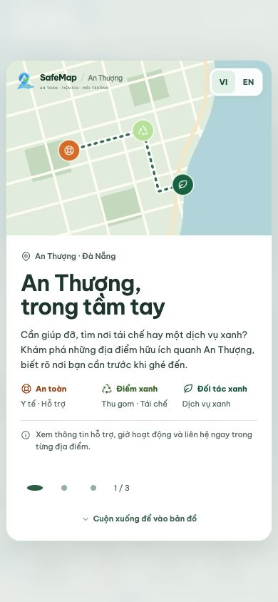
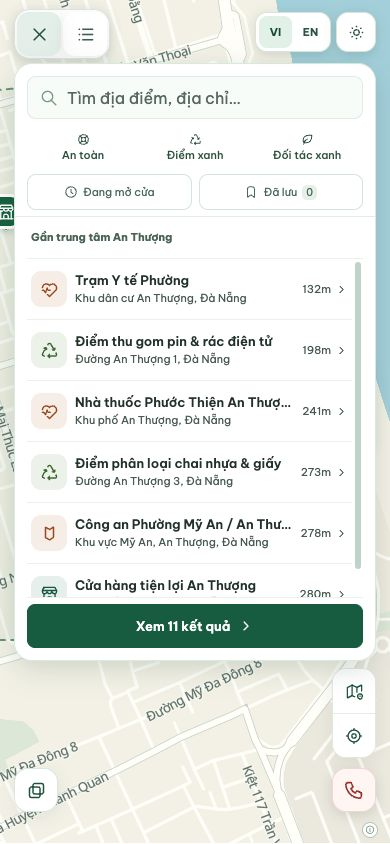
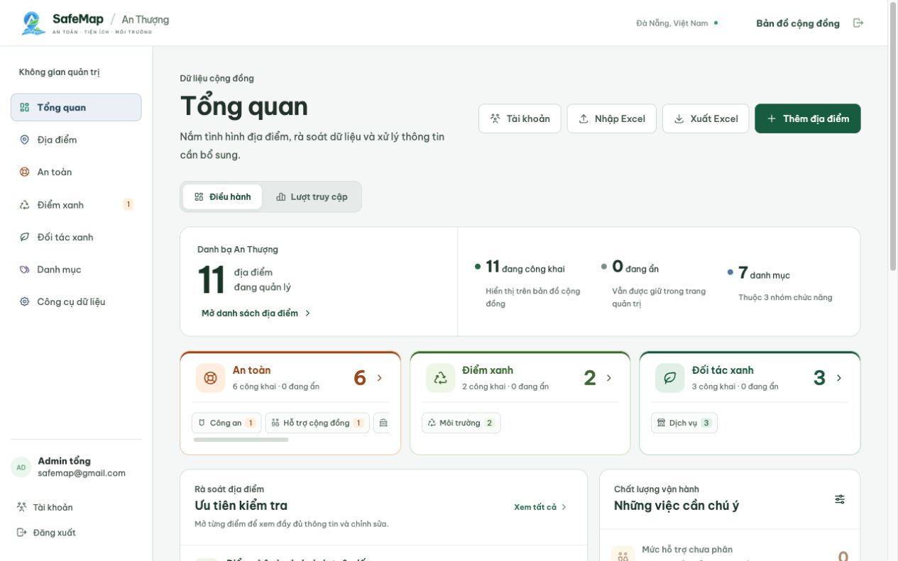
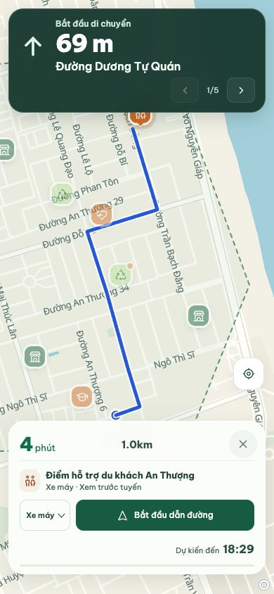
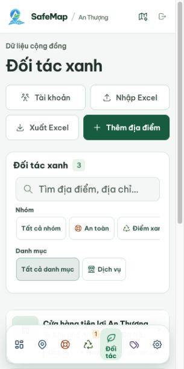

# Rà soát và tinh chỉnh UX/UI SafeMap

Hoàn tất ngày 24/11/2026; ảnh kiểm tra chụp trong hai ngày 23–24/11. Phạm vi là mã nguồn giao diện người dùng và quản trị trong workspace. Chưa triển khai lượt chỉnh này lên Vercel.

Áp dụng [Unslop](https://github.com/heydamir/unslop), tác giả **Damir Sokolovsky**, giấy phép **CC BY 4.0**. Đã đọc [SKILL.md](https://github.com/heydamir/unslop/blob/main/skills/unslop/SKILL.md) cùng các tài liệu signs, tokens, visuals và references. Chọn chế độ tinh chỉnh giao diện đã có; không cài thêm thư viện, sinh ảnh hoặc thay nền tảng sản phẩm.

## Hướng thiết kế

- Sản phẩm: tìm địa điểm và các điểm hỗ trợ tại An Thượng.
- Tính cách: rõ ràng, điềm tĩnh, gần gũi.
- Bối cảnh: bản đồ khu phố và danh bạ địa phương.
- Điểm nhấn: bản đồ, nội dung địa điểm và màu có ý nghĩa phân loại.
- Dấu hiệu thống nhất: icon danh mục đi cùng tên, trạng thái và mức hỗ trợ ở đúng ngữ cảnh.

Giữ logo khách đã chọn, font Be Vietnam Pro, bố cục chính, ảnh URL và các chức năng đang có. Giữ nhóm An toàn màu cam, Điểm xanh xanh nhạt, Đối tác xanh xanh đậm; Safe Point xanh dương, Family Friendly hồng, Safe Hub xanh lá. Icon trên bản đồ tiếp tục thể hiện danh mục; mức hỗ trợ là thông tin bổ sung.

## Các vấn đề đã xử lý

| Vị trí | Vấn đề quan sát | Kết quả |
| --- | --- | --- |
| Tìm kiếm mobile | Địa chỉ và nhãn phụ quá nhỏ; phản hồi có nhiều lớp xuất hiện | Tên kết quả 13px, địa chỉ 11px; hàng tối thiểu 60px; giữ tên/địa chỉ một dòng với ellipsis; giảm số lớp và độ trễ hiệu ứng |
| Popup giới thiệu | Nền màu và blur lớn cạnh tranh với bản đồ; chữ chú thích có nơi chỉ 8–9px | Nền trung tính, blur giảm từ 34px xuống 12px; nhãn hỗ trợ 11px; giữ ba slide và cách vuốt/cuộn vào bản đồ |
| Màu giao diện | Nhiều sắc xanh gần nhau dùng cho chữ và khung | Bổ sung vai trò màu cho nền, chữ chính, chữ phụ, chú thích và viền; giữ màu có ý nghĩa nghiệp vụ |
| Tổng quan/admin | Nhiều nhãn chữ hoa, độ đậm và hiệu ứng con cùng xuất hiện | Nhãn theo kiểu câu; phần nội dung xuất hiện một lần; giảm độ đậm ở tiêu đề và số liệu; nền thẻ tài khoản không còn gradient |
| Thanh thao tác desktop | Bốn nút trên Tổng quan bị tách thành hai hàng ở 1280px | Giữ nhóm thao tác không co ở kích thước desktop phù hợp; đã đo bốn nút cùng tọa độ dọc và trang không tràn ngang |
| Dock admin mobile | Nhãn 8px; tăng chữ có thể đè icon hoặc bị cắt | Chữ 11px, nút cao tối thiểu 56px, nhãn tối đa hai dòng; dùng “Đối tác” trong dock, tên đầy đủ vẫn ở tiêu đề và nhãn truy cập |
| Form | Nhãn, viền và khoảng cách chưa thống nhất; ô điện thoại hẹp trên mobile | Dùng nhịp cách nhóm rõ hơn, viền và focus đồng nhất; ô điện thoại của form modal chiếm đủ hàng trên mobile; nhập liệu 16px |
| Card địa điểm | Chữ phụ và một số liên hệ khó đọc | Tên rõ hơn, địa chỉ 13px ở phần chi tiết; nhãn thông tin 12px; liên hệ dài có thể xuống dòng trong phần chi tiết |
| Chuyển động | Có transition lên chiều cao, margin/padding và hiệu ứng lặp trên thành phần tĩnh | Bỏ transition các thuộc tính gây bố trí lại; chuyển động bảng/menu chủ yếu dùng opacity và transform; trạng thái tải thật vẫn có phản hồi |
| Chỉ đường | Chú thích nhỏ và hai khối xuất hiện hơi lâu | Chú thích tối thiểu 11px trong phần đã chỉnh; hiệu ứng banner/dock ngắn hơn; khoảng cách, tên đường và dự kiến đến giữ thứ tự ưu tiên |
| Không có kết quả | Rule màu primary mới ghi đè màu CTA vô hiệu hóa | Rule primary chỉ áp dụng khi nút hoạt động; đã xác nhận CTA disabled có nền xám và không thể bấm |

## Các lượt tinh chỉnh

1. **Khoảng cách:** thống nhất khoảng cách phổ biến 8/12/16/20/24px, tách nhóm form rõ hơn, giữ điều khiển cảm ứng đủ chiều cao.
2. **Màu:** làm phần khung trung tính hơn, giữ màu ở nội dung phân loại và hành động chính.
3. **Icon:** tiếp tục dùng bộ Tabler hiện có; bỏ đường trang trí lặp trong phần mở đầu sidebar; không thay icon danh mục đã chốt.
4. **Nội dung:** đổi các nhãn quản trị sang kiểu câu, làm rõ slide tìm địa điểm, bỏ dấu chấm ở các tiêu đề ngắn đã chỉnh; cập nhật cả Việt/Anh.
5. **Chữ:** tăng nhãn phụ quan trọng, giảm độ đậm không cần thiết, giữ các con số theo tabular-nums.
6. **Bố cục:** giữ cấu trúc và thứ tự phần; xử lý hàng thao tác desktop, ô điện thoại mobile và nhãn dock.
7. **Chi tiết:** focus bàn phím rõ, trạng thái disabled phân biệt được, thẻ dài không làm tràn trang, chọn/hover giữ đúng màu nhóm.
8. **Hình ảnh:** bản đồ và ảnh địa điểm tiếp tục là nội dung trực quan; không thêm hình minh họa trang trí hay dependency.
9. **Chuyển động:** dùng easing thống nhất cho các phần đã chỉnh, thời lượng phản hồi ngắn, giữ phần reveal mở đầu; vẫn tôn trọng prefers-reduced-motion.

## Phạm vi kiểm tra

### Trên trình duyệt

Dùng bản xem thử local có backend và dữ liệu giả lập để tránh sửa dữ liệu phường. Đã mở popup ba slide, chuyển Việt/Anh, tìm kiếm/lọc/xóa lọc, trạng thái không có kết quả, chi tiết địa điểm và ba mức hỗ trợ; kiểm tra nền sáng/tối. Đã xem đăng nhập, tổng quan, danh sách, card chỉnh sửa tại chỗ, thêm địa điểm, danh mục, chất lượng dữ liệu, lịch sử/chi tiết lịch sử và tài khoản.

- Mobile: 320×640 và 390×844. Các màn đã đo không làm tràn ngang trang.
- Desktop: 1280×800. Thanh thao tác Tổng quan cùng hàng, sidebar giữ độ rộng đã chốt.
- Đã tải được tuyến xem trước từ điểm xuất phát chọn trên bản đồ qua dịch vụ định tuyến. Khoảng cách, thời gian, dự kiến đến và nút thoát hiển thị; zoom/SOS vẫn ẩn khi ở giao diện chỉ đường.
- Nhãn dock “Đối tác” ở 320px cao hai dòng, còn cách icon hơn 3px.
- CTA không có kết quả được xác nhận disabled, nền `rgb(237, 242, 239)` và không bị tô xanh như nút hoạt động.

### Kiểm tra mã

| Lệnh | Kết quả |
| --- | --- |
| `npm test` | 65 kiểm tra đạt |
| `npm run test:ui` | 212 kiểm tra React DOM đạt |
| `npm run test:sync` | Đạt kiểm tra lưu chậm, observer cũ, lỗi lưu và đăng xuất bằng SDK giả lập |
| `npm run build` | Build production thành công |
| `git diff --check` | Không có lỗi whitespace |

Cảnh báo chunk lớn của Firebase/MapLibre vẫn còn; lượt này không thêm dependency. Không sửa Firestore Rules hoặc thuật toán nghiệp vụ trong phần tinh chỉnh Unslop nên không chạy lại bộ emulator Rules của lượt quản trị trước.

Các kiểm tra viewport và React DOM không thay thế kiểm tra trên iPhone/Android thật, bàn phím ảo, GPS khi di chuyển hoặc đo tốc độ khung hình trên máy yếu. Lượt này không xuất bản production, thay domain hoặc sửa dữ liệu Firebase thật.

## Ảnh đối chiếu

Ảnh dùng dữ liệu minh họa; số liệu và tài khoản trong bản xem thử không đại diện hoạt động thật của phường.

### Giới thiệu

### Tìm kiếm mobile

### Tổng quan admin

### Chỉ đường

### Điều hướng admin 320px

